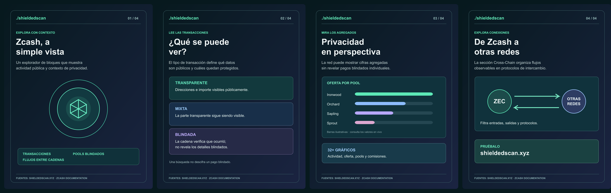

# ShieldedScan: serie educativa para X

Cuatro imágenes en español (1200 × 1500 px), con archivos SVG editables.

[Descargar el paquete PNG + SVG](https://hudwqni1959.github.io/shieldedscan-es/shieldedscan_es_entrega.zip)

Muestra independiente preparada para la convocatoria «Descubre ShieldedScan – Explorador de Zcash». No es material oficial de ShieldedScan ni de ZecHub.

| Lámina | Archivo PNG | Fuente editable |
|---|---|---|
| 1. Qué es ShieldedScan | [PNG](01_portada.png) | [SVG](01_portada.svg) |
| 2. Tipos de transacciones | [PNG](02_transacciones.png) | [SVG](02_transacciones.svg) |
| 3. Pools y gráficos | [PNG](03_pools.png) | [SVG](03_pools.svg) |
| 4. Flujos entre cadenas | [PNG](04_flujos.png) | [SVG](04_flujos.svg) |

El diseño se basa en las funciones visibles de shieldedscan.xyz: explorador de transacciones, pools blindados, gráficos de actividad y sección Cross-Chain. Las barras de la tercera imagen son ilustrativas; no representan saldos actuales.

## Diseño y archivos editables

La revisión del 10 de noviembre utiliza ZH Black Blue (#06192f), ZH Slate Blue (#39516c), blanco y colores auxiliares de la [identidad visual de ZecHub](https://zechub.wiki/visual-identity). La tipografía es Montserrat, la familia secundaria indicada en esa guía; no se ha usado Bossa, la familia principal. Los SVG conservan el texto editable y llevan la fuente incorporada para facilitar su apertura. La licencia SIL Open Font License de Montserrat está en [Montserrat-OFL.txt](Montserrat-OFL.txt). No se incorporan logotipos oficiales.

## Referencias

- https://shieldedscan.xyz/
- https://shieldedscan.xyz/txs
- https://shieldedscan.xyz/shielded
- https://shieldedscan.xyz/charts
- https://shieldedscan.xyz/cross-chain
- https://bounties.zechub.wiki/bounties/cmw9r69350029cv86e2tlsn0c
- https://bounties.zechub.wiki/docs/addresses

## Estado del encargo

Solicitud presentada el 10 de noviembre de 2026, según la confirmación de la plataforma facilitada por el solicitante. Estado observado: pending / Under review. No hay asignación ni pago confirmados. La recompensa publicada es 0.03 ZEC y el plazo indicado es el 22 de noviembre de 2026.

La postulación debe incluir un breve plan, plazo y un enlace pertinente. Después de la aprobación, los PNG y los SVG editables pueden entregarse por enlaces públicos (por ejemplo, en un repositorio del colaborador) según las instrucciones del equipo.
